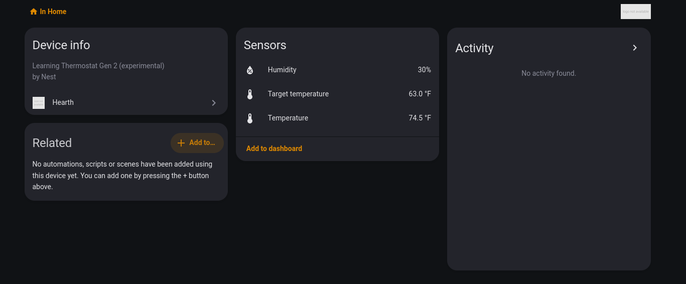

<p align="center">
  
</p>

<h1 align="center">Hearth</h1>

<p align="center">Keep your Nest thermostat. Bring its connected features home to Home Assistant.</p>

<p align="center">
  <a href="https://github.com/tylxr59/Hearth/releases"></a>
  <a href="LICENSE"></a>
  <a href="https://github.com/tylxr59/Hearth/actions"></a>
</p>

<p align="center">
  <a href="#-features">Features</a> · <a href="#-quick-start">Quick start</a> ·
  <a href="#-usage">Usage</a> · <a href="#-troubleshooting">Troubleshooting</a>
</p>

---

Hearth connects a modified Nest Learning Thermostat directly to Home Assistant
through its native local HTTPS protocol. The thermostat keeps its own display,
schedule engine and equipment-control logic. Your HA installation supplies the
connected controls, readings and weather.

<p align="center"></p>

> [!NOTE]
> **Experimental preview.** Real Gen2 telemetry, target changes, Eco and weekly
> schedule replacement/restoration are verified. Actual equipment switching and
> unattended outage behavior still need validation. The guided USB frontend is
> implemented, but a stock thermostat still needs a separately prepared, device-bound
> firmware kit. This is not yet a turnkey installer or a stable v1 release.

## 🎯 Features

| Feature | What it does |
| --- | --- |
| Native HA integration | Climate controls, temperature and humidity through local HTTPS |
| Eco and weekly schedules | Native presets, full-week readback, checked replacement and backups |
| Weather and time | Uses an HA weather entity; local endpoint and chosen time source |
| Device settings | Learning, Early-On, Sunblock, display and equipment configuration, gated by reported support |
| Local operation | Retains Nest's native UI and control loops |
| Guided USB workflow | Identity/bundle checks, protected preflight, explicit install decision and paired restore |

New settings have automated protocol coverage. Their presence in the UI does not
mean every field or equipment configuration has been physically tested. See the
[compatibility matrix](docs/compatibility.md).

## 📋 Requirements

- Nest Learning Thermostat Gen2, reported `Display-2.6`, primary firmware `5.9.4-5`.
- Home Assistant Core2026.10.4 (the tested version) and a network path from the Nest to HA.
- A Linux computer and data-capable USB cable for thermostat installation.
- A private commissioning bundle and separately checked per-device firmware kit.
  See [installation and current limits](docs/installation.md).

## 🚀 Quick start

For an already commissioned thermostat, add
`https://github.com/tylxr59/Hearth` to **HACS → Custom repositories**, category
**Integration**, install Hearth, then restart HA and add **Hearth** under
**Settings → Devices & services**. Tagged previews provide the `hearth.zip`
release asset; before the first tagged preview, use the source packaging steps
in the [installation guide](docs/installation.md).

For a stock thermostat, start with the supported-device and firmware-kit
requirements in that guide. The USB tools can inspect the device without writing:

```sh
python -m installer.cli doctor
python -m installer.cli identify --info 'Technical Info.plist'
```

HACS installs the HA integration. Modifying the thermostat is a separate USB step.

## 🧭 Usage

Use the Hearth climate card for supported modes, target temperature and Eco.
Configuration entities expose reported settings; equipment-specific options are
initially disabled and require supported baselines. Select an existing HA weather
entity in Hearth's options. Schedule actions preserve a private backup before a
revision-checked replacement.

[Controls and schedules](docs/usage.md) · [Installation](docs/installation.md) ·
[Compatibility](docs/compatibility.md) · [Recovery](docs/recovery.md)

## 🩺 Troubleshooting

| Symptom | What to check |
| --- | --- |
| Unavailable readings | Power, Wi-Fi, thermostat-facing HA address and local HTTPS reachability |
| A setting is unavailable | The Nest must report that field and the required equipment capability |
| A target is labelled assumed | A protocol acknowledgement arrived; an explicit native value echo has not |
| Schedule revision changed | Read the latest week before replacing it; do not retry an old action |
| Installer refuses a kit | Check model, firmware, identity, exact originals and matching restore profile |

See [troubleshooting](docs/troubleshooting.md). Never unplug during a persistent
write or assume a failed session is safe to reboot.

## 👋 Development

```sh
python3 -m venv .venv
.venv/bin/pip install --require-hashes -r requirements-dev.lock
make test
make check
```

[Contributor guide](docs/development.md) · [Release checklist](docs/development/roadmap.md) ·
[Research archive](docs/research/) · [Report an issue](https://github.com/tylxr59/Hearth/issues)

## 📦 Releases

The [release workflow](.github/workflows/release.yml) builds a self-contained
`hearth.zip`, a public installer-source archive and checksums from a matching
version tag. Development builds do not update HA or flash a thermostat.

## 🤝 Acknowledgements

[NLE](https://github.com/codykociemba/NoLongerEvil-SelfHosted) provides the pinned
native-protocol reference. Hearth's transport and settings implementations are
original. [NestDFUAttack](https://github.com/exploiteers/NestDFUAttack) and the OMAP
loader projects underpin the reviewed RAM-boot research. See
[licensing and provenance](THIRD_PARTY.md).

## 📃 License

Hearth's original code is available under the [MIT License](LICENSE). Referenced
components retain their own licenses. Proprietary Nest firmware, per-device keys
and owner recovery images are not included in releases.
