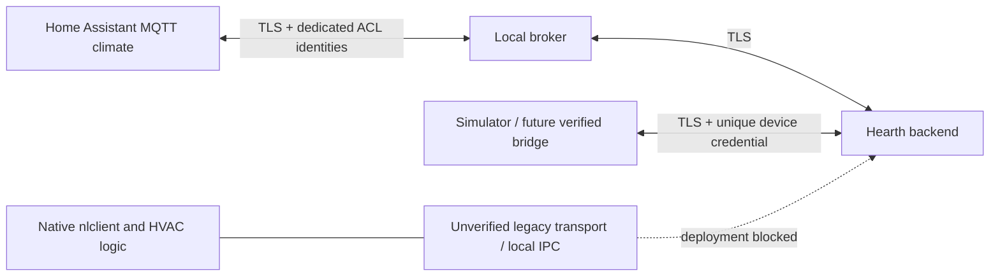

# ADR-0001: retain native control, implement a host transport laboratory

Status: accepted for this iteration; physical deployment blocked. Date: 2026-10-24 (America/New_York).

## Evidence

The historical init script starts `/nestlabs/sbin/nlclient`. Its configuration points software updates at `/nestlabs/sbin/osm`; osm must not be assumed to be the primary control app. SCPM has a D-Bus service, but its observed methods concern power/process lifecycle. A root-only nlclient D-Bus policy establishes a bus name, not any particular temperature setter. At the initial review the proprietary executables were absent. On 2026-10-30, owner-authorized acquisition and offline reconstruction recovered actual nlclient/osm privately.

NLE redirects `cloudregisterurl`, supplies an entry response with local service URLs and implements bucket PUT/long-poll subscribe. Source comments describe sleep/WoWLAN and schedule races, making poll cadence, merged-state echo and stale desired state material correctness concerns. Those comments are upstream observations, not independently measured hardware behavior.

The [native static review](../research/native-interface-2026-10-30.md) traced
three D-Bus registrations to sniffer, power/lifecycle and heartbeat methods.
A separate loopback test-access implementation contains native temperature
queries/setters, but startup/enablement is unproven and its short-read-based TCP
request framing is not established as safe. No runtime setter or usable local
bridge is verified. This narrows the critical unknown; it does not close it.

The [follow-up Ghidra/TLS review](../research/native-tls-2026-10-30.md)
supports dormant test-access startup and identifies native callback exceptions
for future-dated certificates and selected CRL failures. The host transport stays
provisional; CA replacement alone is insufficient. A private, uninstalled
single-instruction default-callback candidate is statically reviewed, with target
TLS/time/CRL and restoration/commissioning validation still required.

The [credential/bootstrap follow-up](../research/native-bootstrap-2026-10-30.md)
corroborates native assigned credentials and response-header updates, but also
finds credential logging and default fallback after a 401. A private logging
remediation candidate is statically reviewed. These findings narrow commissioning
requirements; they do not establish trusted bootstrap, durable rotation or a
production-compatible transport. Keep the same provisional architecture.

The [supervised TLS callback result](../research/tls-probe-result-2026-10-30.md)
now confirms the candidate accepts valid and rejects eight invalid fixture cases
on device loopback, with native startup return. This closes that bounded callback
measurement, not full native fetch/configuration, storage, commissioning or
transport compatibility. The provisional architecture and deployment gates remain.

## Decision

Preserve nlclient, backplate firmware, drivers, watchdog, SCPM, schedules and unknown services. Build a small host-side authenticated API and MQTT boundary with a partial legacy decoder for research. Choose a provisional local cloud-protocol backend because it has demonstrated upstream protocol evidence; retain the identified test-access path as a bridge candidate pending enablement, framing and separately authorized bench evidence. Do not deploy a guessed IPC bridge or a permissive legacy backend.

The canonical `/v1/device/*` API is a new simulation/future-bridge contract; stock Nest does not implement it. The experimental Nest decoder accepts a strict subset of observed PUT data. It has no working pairing, revision synchronization or subscribe/control delivery to a real Nest. Default runtime does not mount its routes.

All non-loopback API traffic uses TLS >=1.2. Devices authenticate with unique credentials checked against SHA-256 digests, management uses a separate Bearer credential, and MQTT uses dedicated broker identities and ACLs. A firewall cannot make plaintext credentials safe.

## Boundaries

Only credential hashes persist in the backend. State and commands are volatile; backend restart starts unavailable with no desired-state replay. Commands expire after 30 seconds; availability expires after 90 seconds of state silence. Local operation must remain independent of all three host services, but that is a hardware validation requirement, not a proven property.

## Alternatives

- On-device bridge: preferred long term if an observable, reliable local control API exists; presently unconfirmed, with old ABI and power-management constraints.
- Copy NLE backend: larger surface and unacceptable authentication/CGI/raw-command behaviors; no code copied.
- Rewrite control/backplate firmware: rejects the preservation requirement and lacks a safety justification.

## Consequences

Python runs on a current host, never imposed on the old ARM userspace. MQTT gives a small HA boundary without a custom HA integration dependency. No management UI or additional UI listener exists; HA is the control UI. Hardware commissioning and secure stock-client transport remain critical path. If TLS cannot be verified on stock nlclient, evaluate a mutually authenticated local tunnel on a proven-compatible runtime; until then keep devices offline, with no plaintext production fallback.

## 2026-10-31 owner decision: native Home Assistant endpoint

The owner explicitly selected a native HA integration and immediate retirement
of Hearth's MQTT deployment after the broker-backed telemetry baseline passed.
The updated target retains the native HTTPS protocol but hosts its receiver
inside HA Core and publishes entity updates directly. The generated integration
package reuses the canonical transport/authentication implementation and excludes
MQTT and provisioning material. It is independently tested against HA2026.10.4.

The integration is now physically observed receiving the three sensor readings,
with owner-confirmed HA display. The old app/bridge is retired and its owned
retained entities cleared. Existing device and server trust/enrollment were retained;
the advertised transport origin uses the owner's IoT address, while the stored
registration URL's final update remains pending. Native command delivery is still
disabled, and the observed Google connectivity/time dependencies remain unresolved.
This supersedes the MQTT host deployment target, without claiming HVAC safety or
complete legacy-protocol/outbound compatibility.
