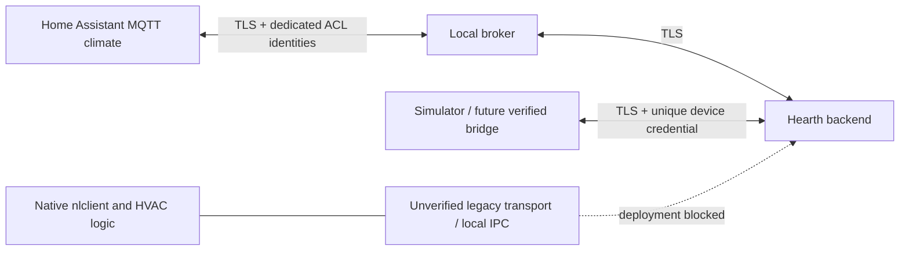

# ADR-0001: retain native control, implement a host transport laboratory

Status: accepted for this iteration; physical deployment blocked. Date: 2026-10-24 (America/New_York).

## Evidence

The historical init script starts `/nestlabs/sbin/nlclient`. Its configuration points software updates at `/nestlabs/sbin/osm`; osm must not be assumed to be the primary control app. SCPM has a D-Bus service, but its observed methods concern power/process lifecycle. A root-only nlclient D-Bus policy establishes a bus name, not any particular temperature setter. The actual proprietary executables are absent from the inspected root tree.

NLE redirects `cloudregisterurl`, supplies an entry response with local service URLs and implements bucket PUT/long-poll subscribe. Source comments describe sleep/WoWLAN and schedule races, making poll cadence, merged-state echo and stale desired state material correctness concerns. Those comments are upstream observations, not independently measured hardware behavior.

## Decision

Preserve nlclient, backplate firmware, drivers, watchdog, SCPM, schedules and unknown services. Build a small host-side authenticated API and MQTT boundary with a partial legacy decoder for research. Choose a provisional local cloud-protocol backend because it has demonstrated upstream protocol evidence; reconsider an on-device bridge after obtaining executable/IPC evidence. Do not deploy a guessed IPC bridge or a permissive legacy backend.

The canonical `/v1/device/*` API is a new simulation/future-bridge contract; stock Nest does not implement it. The experimental Nest decoder accepts a strict subset of observed PUT data. It has no working pairing, revision synchronization or subscribe/control delivery to a real Nest. Default runtime does not mount its routes.

All non-loopback API traffic uses TLS >=1.2. Devices authenticate with unique credentials checked against SHA-256 digests, management uses a separate Bearer credential, and MQTT uses dedicated broker identities and ACLs. A firewall cannot make plaintext credentials safe.

## Boundaries

Only credential hashes persist in the backend. State and commands are volatile; backend restart starts unavailable with no desired-state replay. Commands expire after 30 seconds; availability expires after 90 seconds of state silence. Local operation must remain independent of all three host services, but that is a hardware validation requirement, not a proven property.

## Alternatives

- On-device bridge: preferred long term if an observable, reliable local control API exists; presently unconfirmed, with old ABI and power-management constraints.
- Copy NLE backend: larger surface and unacceptable authentication/CGI/raw-command behaviors; no code copied.
- Rewrite control/backplate firmware: rejects the preservation requirement and lacks a safety justification.

## Consequences

Python runs on a current host, never imposed on the old ARM userspace. MQTT gives a small HA boundary without a custom HA integration dependency. No management UI or additional UI listener exists; HA is the control UI. Hardware commissioning and secure stock-client transport remain critical path. If TLS cannot be verified on stock nlclient, evaluate a mutually authenticated local tunnel on a proven-compatible runtime; until then keep devices offline, with no plaintext production fallback.
